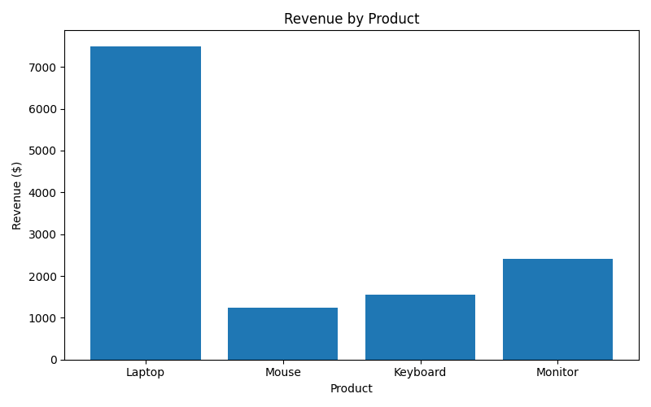
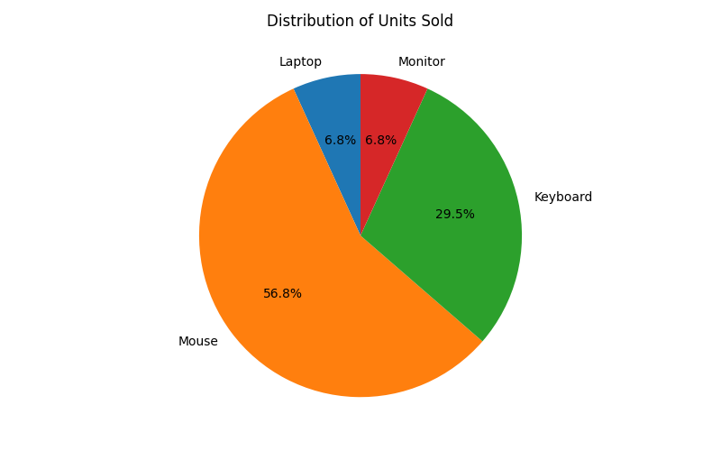

# Python Sales Analysis

A beginner-friendly Python project focused on analyzing sales data, calculating business metrics, and generating visual insights using Matplotlib.

## Project Overview

This project analyzes a sales dataset stored in a CSV file. It calculates key business metrics and generates charts to help understand product performance.

The goal is to demonstrate basic data analysis skills using Python, data processing, and visualization.

## Technologies Used

- **Python** – Data processing and calculations.
- **CSV** – Data storage and input.
- **Matplotlib** – Data visualization.

## Key Metrics

The analysis generates the following results:

| Metric | Result |
|---|---:|
| Total Revenue | $12,710.00 |
| Total Units Sold | 44 |
| Best-Selling Product by Revenue | Laptop |

## Data Visualizations

### 1. Revenue by Product

This bar chart compares the total revenue generated by each product.



### 2. Distribution of Units Sold

This pie chart shows the percentage of total units sold by product.



## Project Structure

```text
python-sales-analysis/
│
├── data/
│   └── sales.csv
│
├── charts/
│   ├── revenue_by_product.png
│   └── units_distribution.png
│
├── sales_analysis.py
├── README.md
├── LICENSE
└── .gitignore
```

## How to Run the Project

1. Clone the repository:

```bash
git clone https://github.com/lucasgaro-dev/python-sales-analysis.git
```

2. Navigate to the project folder:

```bash
cd python-sales-analysis
```

3. Install the required library:

```bash
pip install matplotlib
```

4. Run the analysis:

```bash
python sales_analysis.py
```

The program will display the sales report and automatically generate two charts inside the `charts/` folder.

## Learning Objectives

Through this project, I practiced:

- Reading and processing CSV files with Python.
- Performing calculations and aggregating sales data.
- Identifying top-performing products.
- Creating data visualizations with Matplotlib.
- Organizing and documenting a Python project using Git and GitHub.

## Author

**Lucas García**

GitHub: [@lucasgaro-dev](https://github.com/lucasgaro-dev)
